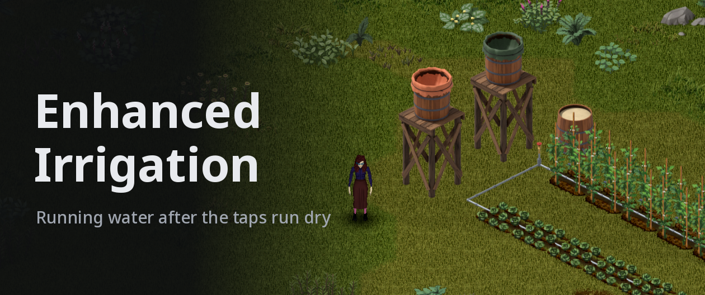
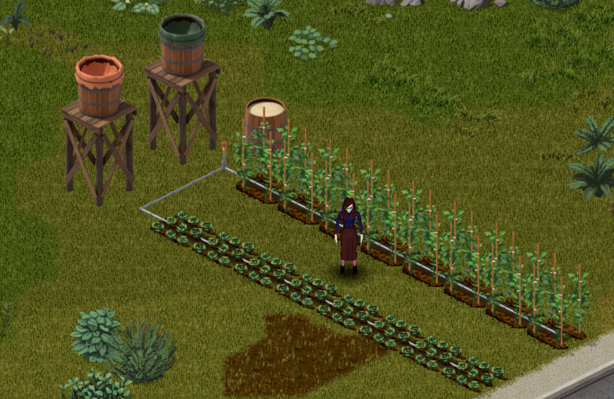
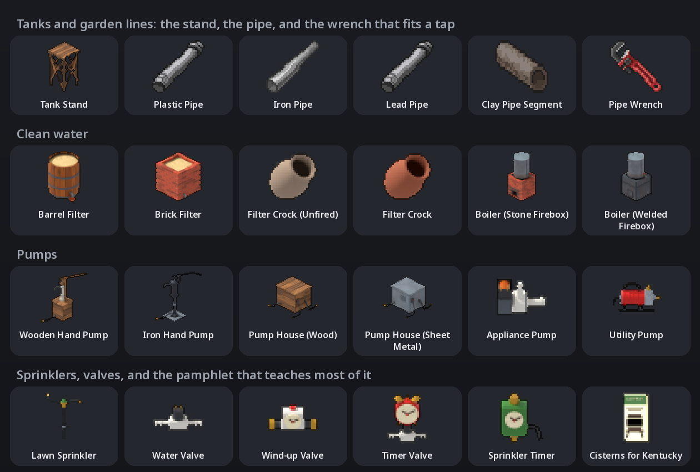
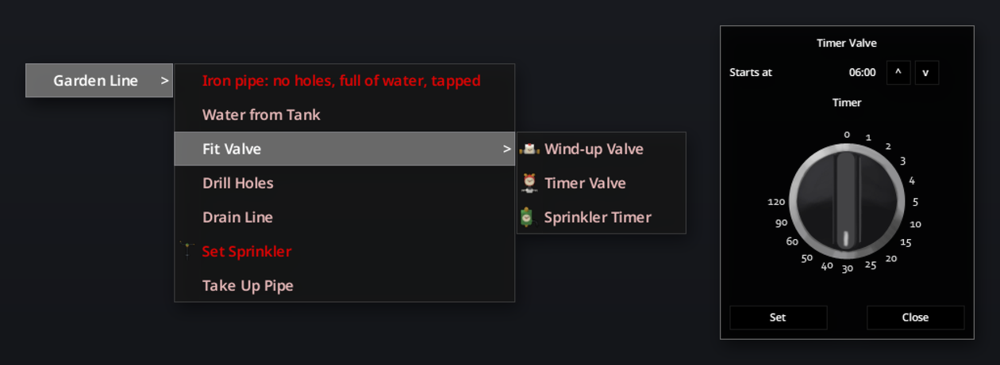
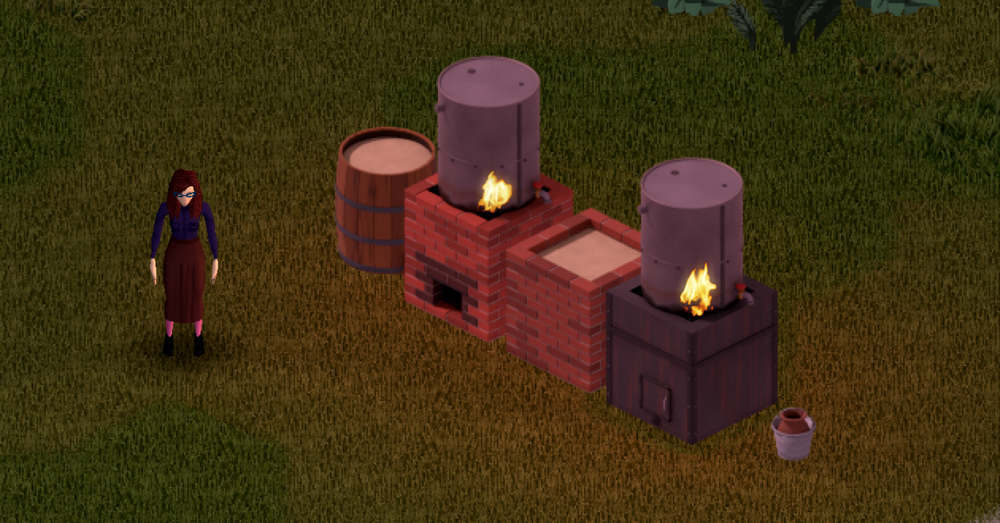
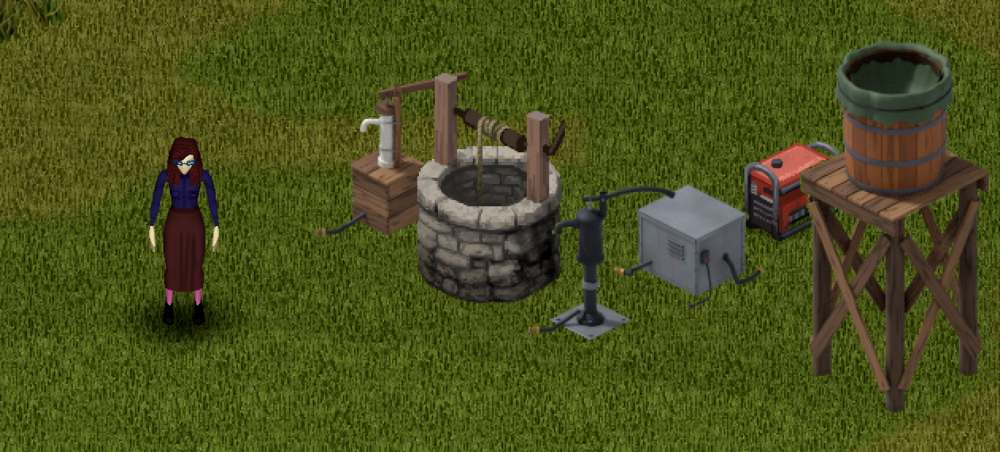
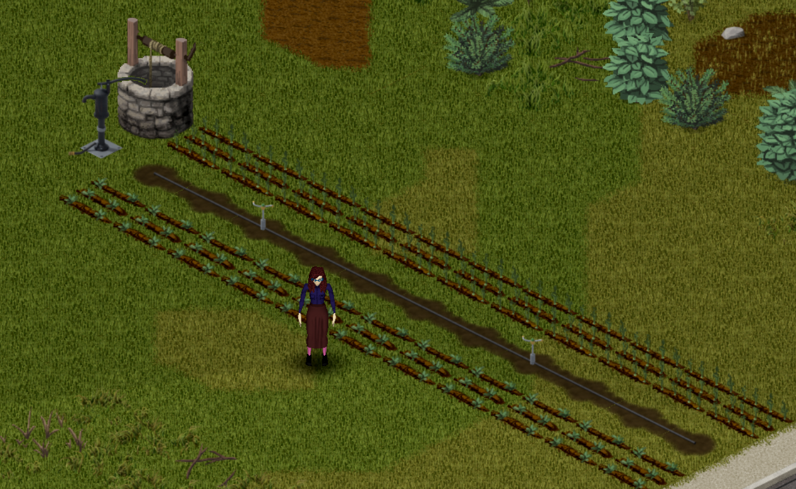

# 

*Work in progress: still being balanced and updated. Feedback is welcome in the comments.*

Get running water back after the taps run dry, with what a Kentucky farm had in 1993: a rain barrel up on a log stand, pipe laid down the garden rows, sinks plumbed to a tank, a sand filter or a wood-fired boiler for drinking water, and a pump on the well. You start with one raised barrel and a line you hold open, bed by bed. Every length of pipe is one you scavenged or fired, every pump seal wears through, and nothing in it knows whether it rained.

**Build 42.21 or newer.** Single player and multiplayer. Fine to add to a save in progress. Requires **cf_commonlib**.

**[The player's guide](docs/player-guide.md)** explains every system: how high a tank has to stand, sizing a line, keeping a filter alive, what a pump lifts, and where to look.

## Questions

- **Can I add it to my save?** Yes. Barrels already in your world count as tanks at once; the pamphlet and the parts turn up in containers nobody has opened yet.
- **Can I remove it?** Not cleanly: what it built into your world goes with it.
- **Why is my rooftop barrel's water tainted now?** Vanilla's plumbing purified anything that came through a pipe. Here water keeps its taint until you clean it. Turn off **Plumbing keeps taint** on the **Enhanced Irrigation** sandbox page and vanilla's **Plumb** purifies again; a sink the mod already changed over needs unplumbing and plumbing again.
- **Can I make it easier, or harder?** Yes, on the **Enhanced Irrigation** sandbox page: how often the pamphlet and the parts turn up, and whether plumbing keeps taint.
- **Does it change vanilla farming?** No. Rain and watering cans work as before; only water you run through a line or a sprinkler can drown a bed.
- **Do I need Renewable Energy?** No. With it, a battery bank powers your Pump Houses and timers, and bills the pumps like any appliance.

## How it plays

| When | What you're after | What it takes |
|---|---|---|
| The first planting | A bed that waters while you stand at the tap | A Tank Stand and a rain barrel, a few lengths of pipe and their joints, a drill or an awl, a Pipe Wrench |
| A month or so in | The kitchen sink and the toilet working again, and water you can drink | Barrels plumbed into a cistern, a second tank kept clean, a Barrel Filter of sand, gravel and charcoal that you keep alive, or a Filter Crock from the kiln |
| Months later | No more hauling | A hand pump on a well, a barrel or the river, pipe for its outlet, and the sweat to work it; a Brick Filter or a boiler for more clean water |
| The long haul | A garden that waters itself every evening | A Pump House with a salvaged or scavenged pump on a generator, a Timer Valve, lawn sprinklers on the pumped line |

## Everything you can find or build

- **Tanks.** A **Tank Stand** lifts a rain barrel a storey, and **Plumb to Tank** joins barrels into a cistern with buried pipe, up to 10 tiles.
- **Garden lines** of plastic, iron, lead or clay pipe, holed under the plants, with a tap at the tank. Overwater and the roots rot; leave them full in a hard frost and they split.
- **Plumbed fixtures.** Sinks, baths, showers, toilets and washing machines run from the tank you pick, each its own.
- **Clean water** from a **Barrel Filter** or a **Brick Filter** that ripens for three days and dies if it dries out, a **Filter Crock** you shape and fire, or a **Boiler** you keep fed like any fire.
- **Pumps.** A **Wooden Hand Pump** or an **Iron Hand Pump** with a leather, rubber or tarp seal that wears through, and a **Pump House** for an **Appliance Pump** salvaged from a washer or a found **Utility Pump**.
- **Running it for you.** A **Lawn Sprinkler** on a pumped line waters a 5 by 3 patch. A **Wind-up Valve** shuts the tap for you, and a **Timer Valve** or **Sprinkler Timer** opens it at the same hour every day, power permitting. You salvage the **Water Valve** for it from a washer.
- ***Cisterns for Kentucky***, the extension pamphlet that teaches most of it.

## Getting started

1. Build a **Tank Stand** (it's with the rain collectors in the build menu), or put a barrel on a deck or a floor a storey up.
2. Carry an empty rain barrel to the stand and **Set Barrel on Stand**. Open its lid for the rain.
3. Carrying pipe and its joints, right-click the ground beside it and **Lay Line** along the bed, on the plants' own squares.
4. **Drill Holes** under the plants, then **Fit Tap** beside the barrel with a Pipe Wrench.
5. Stand at the tap: **Water from Tank**. The soil darkens under every hole.

A tap runs only from a tank at least a storey above it, and a higher one pushes harder. A barrel on the ground waters nothing.

## Clean water

Rain comes down tainted, and so does the river. A sand filter is slow, about 100 L a day from a barrel's worth of sand, and alive: give it three days to ripen before you trust it, and water it every day or two, or the film that does the cleaning dies and it starts over. A boiler is quick, about 30 L an hour, but it burns fuel all the while, and ten hours of fire with the drum dry burn it through. Keep the clean tank's lid shut; one careless bucket spoils it.

## Pumps

A hand pump on a well gives clean water forever, at about 60% of your endurance an hour, and the wooden one squeals loud enough to bring company. A Pump House does the work on the grid while it lasts, if it stands in or beside a house, then on a generator's fuel. Run one with nothing to draw and it burns out, and every repair brings it back a little less.

## Crafting

Learn the recipes from *Cisterns for Kentucky*, by levelling Carpentry, Welding, Masonry, Pottery or Electricity, or by researching a part you found. Builds and crafts need light to see by, and the valves and the Utility Pump a table. Laying pipe, drilling, fitting taps and watering take no learning at all. Every recipe is on [one sheet](art/promo/images/recipes.png).

## Where to look

Think about who kept water moving in 1993: farmers and gardeners, plumbers and the hardware store. Pipe is in warehouses and on building sites, the pamphlet on a garden centre's shelves, and the good pumps and timers in town, where the dead are. Every washing machine and dishwasher hides a pump and a valve, if you don't mind the laundry.
